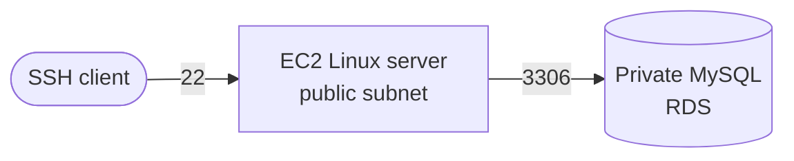

# Private MySQL on RDS, reached from EC2

  

A database nothing outside the VPC can reach, queried from an EC2 instance, with two tables that answer a question neither one answers alone.

**Lab 162 complete: Canvas 1/1, 11 October 2026.** The later evidence rerun captured the seven required query screenshots before ending the sandbox.

## What I built

| Component | Setting that mattered |
|---|---|
| RDS instance | Verified rerun: MySQL 8.4.11, Single-AZ, db.t3.micro, 20 GiB gp2 |
| Placement | Lab VPC, public access **No** |
| Subnet group | Private database placement; multiple subnets do not by themselves enable Multi-AZ failover |
| Security group | One rule: 3306, sourced from the server's security group |
| Schema | `RESTART` and `CLOUD_PRACTITIONER`, joined on the student ID |

Original schema notes: [`schema.sql`](schema.sql). The verified rerun used `StudentID`, `StudentName`, `RestartCity`, `GraduationDate`, and `CertificationDate`. Its exact commands and results, using generic sample student records, are in [`verified-query-session.txt`](verified-query-session.txt). The original notes are not the execution transcript.

## The decision that mattered

The inbound rule points at the Linux server's security group, not a CIDR block.

A broad CIDR can admit other hosts in the same address range. Referencing the application security group narrows the permitted source to network interfaces carrying that group. That is a network-membership control, not a replacement for database authentication.

<b>You: and the schema</b>

 

`CLOUD_PRACTITIONER` carries a student ID and a date, nothing else. Every other detail already lives in `RESTART`, and duplicating it lets the two tables disagree about the same person. `student_id` is the primary key on `RESTART`, so the join has one match per side and cannot multiply rows.

The final query is an inner join because only students in both tables actually passed. A left join keeps the other five with a `NULL` date, which is the version to run when the question is who has **not** certified yet.

## Evidence

The October 11 rerun verified 10 rows in `RESTART`, five in `CLOUD_PRACTITIONER`, and five matching rows in the final inner join. The database connection used certificate-verified TLS. The [saved query session](verified-query-session.txt) contains the actual commands and results.

The separate private submission report includes all seven required query screenshots, RDS availability, and Canvas completion. Raw console screenshots are not published here because they contain account context. See the [challenge index](../challenges/#162-build-and-access-an-rds-server).

## What broke

In the earlier session, the lab timer ran out before the query output was captured, and the RDS instance went with it. The October evidence rerun solved that gap rather than presenting reconstructed output as an original screenshot.

The lesson is about sequencing rather than AWS. Capture evidence as each step passes instead
of collecting it at the end, because the end is exactly when the environment disappears.
The successful rerun was submitted and the lab ended after verification. Its historical endpoint is not a maintained public demo.
